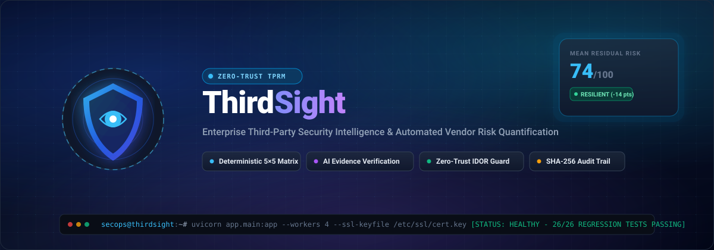
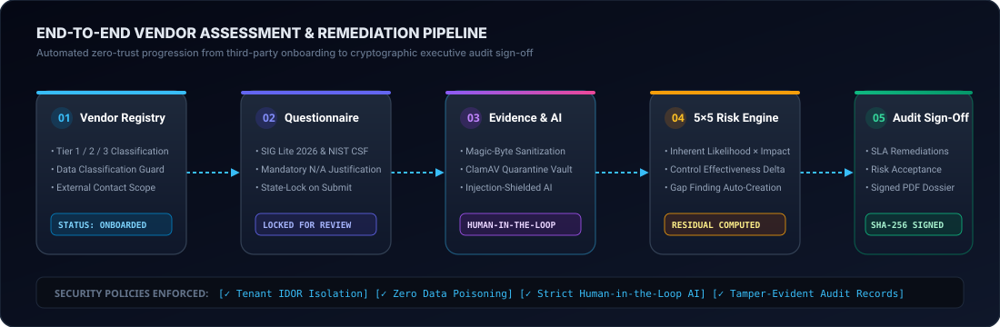
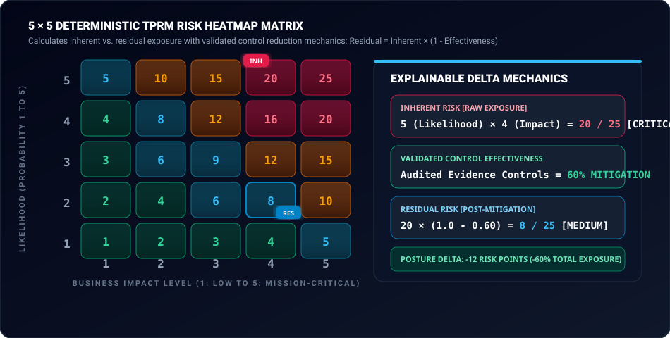
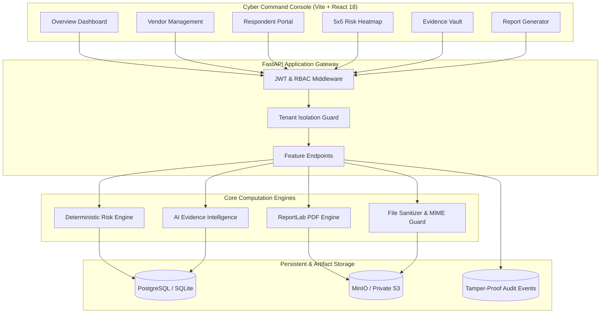

<div align="center">



<br/><br/>

[](https://fastapi.tiangolo.com)
[](https://reactjs.org)
[](https://www.typescriptlang.org)
[](https://tailwindcss.com)
[](https://python.org)
[](https://docs.pytest.org)
[](#-security-controls--defense-in-depth)

<br/>

<p align="center">
  <b>ThirdSight</b> is a defense-in-depth <b>Third-Party Risk Management (TPRM)</b> platform designed to automate vendor security assessments, validate evidence artifacts, calculate deterministic 5×5 risk heatmaps, track gap remediation lifecycles, and generate cryptographically signed executive audit reports.
</p>

[Key Capabilities](#-key-capabilities) • [Pipeline Workflow](#-end-to-end-vendor-assessment-pipeline) • [Risk Heatmap](#-deterministic-5x5-risk-quantification) • [Architecture](#-system-architecture) • [Quick Start](#-quick-start) • [Security](#-security-controls--defense-in-depth)

</div>

---

## ⚡ Key Capabilities

<table>
  <tr>
    <td width="50%" valign="top">
      <h3>🏢 Vendor Inventory & Tiering</h3>
      <ul>
        <li>Dynamic multi-tenant supplier directory with automated tiering (<b>Tier 1 Mission-Critical</b>, <b>Tier 2 High</b>, <b>Tier 3 Medium/Low</b>).</li>
        <li>Granular data classification tracking: <code>Public</code>, <code>Internal</code>, <code>Confidential</code>, and <code>Restricted</code>.</li>
        <li>Continuous monitoring of vendor posture scores and active questionnaires.</li>
      </ul>
    </td>
    <td width="50%" valign="top">
      <h3>📋 Questionnaire Engine & Locking</h3>
      <ul>
        <li>Version-controlled questionnaire authoring (<b>SIG Lite 2026</b>, <b>NIST CSF 2.0</b>, <b>ISO 27001</b>).</li>
        <li>Mandatory justification rules requiring detailed rationale for <code>N/A</code> and <code>Partial</code> responses.</li>
        <li>Automated submission state locks preventing tamper once submitted for SecOps review.</li>
      </ul>
    </td>
  </tr>
  <tr>
    <td width="50%" valign="top">
      <h3>🛡️ Evidence Vault & Quarantine</h3>
      <ul>
        <li>Secure upload pipeline with <b>magic-byte format verification</b> preventing MIME spoofing attacks.</li>
        <li>SHA-256 integrity hashing and ClamAV quarantine isolation.</li>
        <li>Audit review workflows with approval, rejection reasons, and expiration tracking.</li>
      </ul>
    </td>
    <td width="50%" valign="top">
      <h3>🤖 Human-in-the-Loop AI Intelligence</h3>
      <ul>
        <li>Automated policy extraction, document summarization, and control mapping suggestions.</li>
        <li><b>Built-in Prompt Injection Defense Shield</b> cleanses untrusted vendor artifacts before model inference.</li>
        <li>Strict advisory role: AI never approves vendors or accepts risk autonomously.</li>
      </ul>
    </td>
  </tr>
  <tr>
    <td width="50%" valign="top">
      <h3>📊 Deterministic 5×5 Risk Engine</h3>
      <ul>
        <li>Mathematical formula coupling raw vendor exposure with audited control effectiveness.</li>
        <li>Visual <b>5×5 Likelihood vs. Impact Heatmap</b> with pin markers for Inherent (<code>INH</code>) and Residual (<code>RES</code>) states.</li>
        <li>Automatic security gap findings generation with remediation action plans.</li>
      </ul>
    </td>
    <td width="50%" valign="top">
      <h3>📑 Cryptographic Audit Reports</h3>
      <ul>
        <li>On-demand dual PDF reports: <b>Executive Scorecard</b> and <b>Technical Audit Dossier</b>.</li>
        <li>Cryptographic SHA-256 integrity stamp ensuring tamper-proof report verification.</li>
        <li>Continuous monitoring alerts, reassessment reminders, and CSV audit event exports.</li>
      </ul>
    </td>
  </tr>
</table>

---

## 🔄 End-to-End Vendor Assessment Pipeline

The entire vendor evaluation workflow follows a structured zero-trust lifecycle:

<div align="center">
  
</div>

---

## 📊 Deterministic 5×5 Risk Quantification

ThirdSight strictly prohibits numerical hallucination. Risk calculations are completely explainable, auditable, and mathematically reproducible:

<div align="center">
  
</div>

### Risk Reduction Formula
$$\text{Inherent Risk} = \text{Likelihood} \times \text{Impact} \quad (1 \le \text{Score} \le 25)$$

$$\text{Control Effectiveness} = \frac{\sum (\text{Validated Control Weights})}{\text{Total Applicable Weights}} \quad (0.0 \le \text{Eff} \le 1.0)$$

$$\text{Residual Risk} = \text{Round}\left(\text{Inherent Risk} \times (1 - \text{Control Effectiveness})\right)$$

### 5×5 Risk Severity Bands
| Score Range | Severity Band | Response SLA | Remediation Requirement |
| :---: | :---: | :---: | :---: |
| **16 – 25** | 🔴 **CRITICAL** | 24 Hours | Immediate CISO-level remediation plan required |
| **10 – 15** | 🟠 **HIGH** | 7 Days | Corrective action plan with monthly progress audits |
| **5 – 9** | 🟡 **MEDIUM** | 30 Days | Compensating control implementation |
| **1 – 4** | 🟢 **LOW** | 90 Days | Accepted operational posture; monitored annually |

---

## 🏗️ System Architecture



---

## 🎨 Design System: Cyber Command Aesthetic

ThirdSight features a high-contrast **Cyber Command Center** interface crafted with Tailwind CSS and glassmorphism accents:

| Token | Class | Semantic Purpose |
| :--- | :--- | :--- |
| **Canvas** | `bg-slate-950` | Ultra-deep command center canvas with micro-grid background pattern |
| **Glass Panel** | `bg-slate-900/80 backdrop-blur-xl` | High-fidelity frosted cards with subtle specular top borders |
| **Accent Glow** | `shadow-glow-cyan`, `shadow-glow-brand` | Tactical neon glow effects for active controls, badges, and alerts |
| **Critical** | `text-rose-400 bg-rose-950/60` | High-visibility danger indicators for severe security gaps |
| **Mitigated** | `text-emerald-400 bg-emerald-950/60` | Validated controls and resilient residual risk scores |

---

## 🚀 Quick Start

### Prerequisites
- **Python 3.11+**
- **Node.js 18+ & npm**
- **Git**

### 1. Clone the Repository
```bash
git clone https://github.com/yuktac1011/ThirdSight.git
cd ThirdSight
```

### 2. Backend Setup
```bash
cd backend

# Create virtual environment
python -m venv venv
# On Windows:
.\venv\Scripts\activate
# On Linux/macOS:
source venv/bin/activate

# Install dependencies
pip install -r requirements.txt

# Run database migrations / seed built-in controls (NIST, ISO 27001, SOC 2)
python -c "from app.core.database import Base, engine; from app.core.init_db import seed_roles_and_permissions; from app.core.init_controls import seed_controls_and_frameworks; from app.core.database import SessionLocal; Base.metadata.create_all(bind=engine); db = SessionLocal(); seed_roles_and_permissions(db); seed_controls_and_frameworks(db); db.close()"

# Start FastAPI development server
uvicorn app.main:app --host 127.0.0.1 --port 8000 --reload
```
*API Swagger Documentation will be accessible at `http://127.0.0.1:8000/docs`.*

### 3. Frontend Setup
```bash
cd ../frontend

# Install dependencies
npm install

# Start Vite Cyber UI development server
npm run dev
```
*Web application will be accessible at `http://localhost:3000` or `http://localhost:5173`.*

### 4. Running the Test Suite
The codebase includes comprehensive unit, integration, and security regression tests:
```bash
# In the backend directory:
pytest tests -v
```
**Current Test Coverage**:
- `test_assessments.py`: Full assessment lifecycle, state locks, tenant isolation.
- `test_auth_and_rbac.py`: Identity verification, RBAC rules, token expiration.
- `test_evidence_and_controls.py`: Magic byte checking, quarantine handling, framework mapping.
- `test_questionnaires.py`: Questionnaire versioning, assignment, mandatory justifications.
- `test_reports_and_monitoring.py`: PDF generation stream, SHA-256 hashes, audit exports.
- `test_risk_and_ai.py`: Formula reproducibility, residual risk calculations, prompt injection defense.
- `test_vendors.py`: Multi-tenant vendor isolation, duplicate prevention, IDOR guards.

---

## 🔒 Security Controls & Defense in Depth

ThirdSight adheres to a strict Zero-Trust architectural philosophy:

- **IDOR & Cross-Tenant Defense**: All database queries enforce strict `organization_id` scoping derived directly from verified JWT claims.
- **Strict Role-Based Access Control (RBAC)**: Distinct permissions for `admin`, `analyst`, `auditor`, and `vendor_user`.
- **MIME & Antivirus Quarantine**: Uploaded files pass through magic-byte validation and SHA-256 hashing before relocation from quarantine.
- **Tamper-Evident Audit Trail**: Every status transition, remediation creation, risk acceptance, and report export is recorded in immutable audit tables.
- **Prompt Injection Defense**: Sanitizes documents against malicious jailbreak instructions before providing LLM analysis.

---

## 📚 Technical Documentation Index

Detailed architectural blueprints and specifications are available in the [`docs/`](docs/) directory:

- 🏛️ [System Architecture](docs/ARCHITECTURE.md)
- 📋 [Product Requirements Document (PRD)](docs/PRODUCT_REQUIREMENTS.md)
- 🦹 [Threat Model & STRIDE Analysis](docs/THREAT_MODEL.md)
- 🔐 [Security Controls Specification](docs/SECURITY.md)
- 🗄️ [Data Models & Entity Relationships](docs/DATA_MODEL.md)
- 📐 [Deterministic Risk Methodology](docs/RISK_METHODOLOGY.md)
- 🔌 [OpenAPI Specification](docs/API_SPECIFICATION.md)
- 🚢 [Production Deployment & Hardening](docs/DEPLOYMENT.md)
- 🧪 [Testing & Verification Strategy](docs/TESTING.md)
- 🗺️ [Implementation Roadmap](docs/ROADMAP.md)

---

## ⚖️ License & Compliance Disclaimer

Distributed under the Apache 2.0 License.

*Disclaimer: ThirdSight is designed to significantly minimize third-party exposure and streamline TPRM workflows. No software system can guarantee 100% immunity against sophisticated cyber threats. Risk methodologies, framework mappings, and control evaluations should always be reviewed by certified security professionals (CISSP, CISA) in accordance with applicable industry regulations (ISO 27001, SOC 2, HIPAA, GDPR).*
