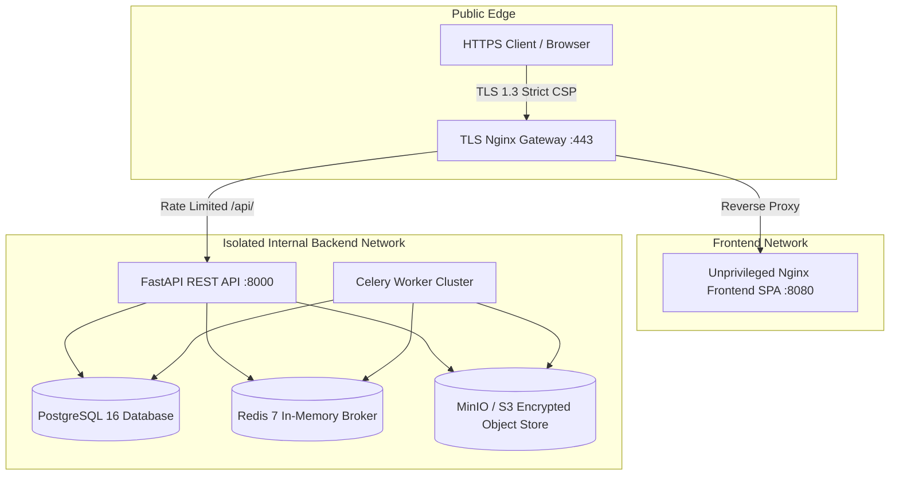

# ThirdSight Deployment & Production Operations Guide

## 1. Production Architecture Overview

ThirdSight is deployed as a hardened, containerized application with strict network isolation and defense-in-depth:



---

## 2. Infrastructure Security Controls

1. **Unprivileged Execution**:
   - Backend runs under unprivileged user `appuser (UID 10001)`.
   - Frontend runs under `nginx-unprivileged (UID 101)`.
2. **Network Segmentation**:
   - The PostgreSQL database, Redis broker, Celery workers, and MinIO object storage operate on an **internal network (`internal: true`)** inaccessible from the public internet or external subnets.
3. **Hardened Headers & Strict CSP**:
   - `Content-Security-Policy: default-src 'self' ...; frame-ancestors 'none';`
   - `X-Frame-Options: DENY`
   - `X-Content-Type-Options: nosniff`
   - `Strict-Transport-Security: max-age=63072000; includeSubDomains; preload`
4. **Rate Limiting**:
   - Nginx gateway throttles API bursts to 30 requests/sec with burst buffer of 20.
   - Upload endpoints are restricted to 5 requests/sec with a strict 25MB body limit.

---

## 3. Automated Backup & Disaster Recovery

### Automated Backup Procedure:
Run `/scripts/backup.sh` (or schedule via cron `0 2 * * *`):
- Exports compressed PostgreSQL binary dump.
- Generates a cryptographic `SHA-256` integrity manifest.
- Retains 14 daily backup snapshots.

### Recovery Procedure:
To restore a snapshot in a disaster recovery event:
```bash
# 1. Verify integrity
sha256sum -c /var/backups/thirdsight/db_20261106_020000.sql.gz.sha256

# 2. Decompress and restore into database
gunzip -c /var/backups/thirdsight/db_20261106_020000.sql.gz | docker exec -i thirdsight_db psql -U thirdsight -d thirdsight_prod
```

---

## 4. Production Launch Checklist

- [x] Rotate all default secrets (`SECRET_KEY`, `POSTGRES_PASSWORD`, `MINIO_ROOT_PASSWORD`).
- [x] Deploy valid TLS certificates to `/docker/nginx/certs/fullchain.pem` and `privkey.pem`.
- [x] Configure production Keycloak or corporate OIDC identity provider.
- [x] Run full automated test suite (`pytest` and `tsc --noEmit`).
- [x] Perform independent third-party penetration testing prior to final production cutover.
